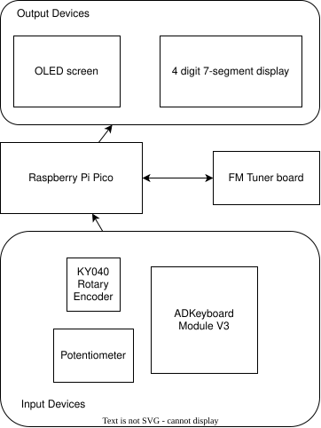

# Group Project: FM Radio Reciever for Raspberry Pi Pico W
[Project Preview](https://www.youtube.com/watch?v=dQw4w9WgXcQ&list=RDdQw4w9WgXcQ&start_radio=1)

## Group Members
- Áron Kristofori
- Ondřej Polášek

# Top-Level schematic

## Hardware Used
1. Raspberry Pi Pico W
2. SI4703 I2C FM Tuner
3. I2C OLED Display Module - RDS Information (SH1106)
4. Potentiometer - Volume setting
5. 4-Digit LED Display - Frequency display (TM1637)
6. Rotary Encoder - Frequency tuning (KY040)
7. ADKeyboard Module V3
   
## Libraries used
I2C, SH1106_I2C, TM1637.hs

## Responsibilities
Aron - 3d printed faceplate, peripherals (OLED, 7-segment, rotary encoder, potentiometer, ADKeyboard Module V3)
Ondra - SI4703 library

## Pin/Bus Plan

|Pins |Device |
|---|---|
|#31 ADC0; #33 AGND | Potentiometer |
|#32 ADC1; #33 AGND | ADKeyboard Module V3|
|#9 DIO ; #10 CLK | 4-digit 7-segment display|
|#14 SW; #15 DT; #16 CLK | KY-040 Rotary Encoder|

Bus Plan
|Bus |Device |
|---|---|
|I2C0 (#6 SDA, #7 SCL)| SI4703 FM Tuner|
|I2C0 (#6 SDA, #7 SCL)| SH1106 OLED Display|
